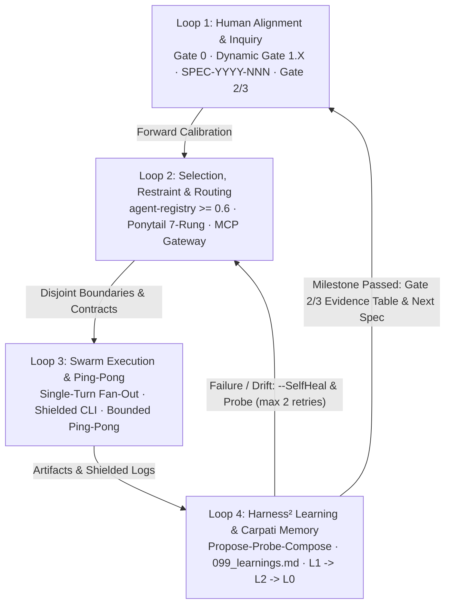

<div align="center">


# AGI

**Autonomous Cognitive Engineering Plugin for Antigravity**

[English](README.md) | [Русский](README.ru.md)

[](https://opensource.org/licenses/MIT)
[](plugin.json)
[](#66-skills)
[](#24-sdlc-specialist-agents)
[](#7-core-rules-and-mcp-gateway)
[](#lifecycle-hooks-architecture)

*Carpati 2-Layer Memory · Dynamic Inquiry Gates · Ponytail 7-Rung Restraint · Harness² Self-Healing CI/CD · UI/UX Swarm · 24 SDLC Specialists*

</div>

---

## Vision

**AGI** transforms an AI coding assistant from a stateless, one-shot generator into a **closed-loop cognitive engineering system** for Antigravity. Instead of dumping unverified boilerplate into your repository, AGI coordinates every task through four coupled execution invariants:

1. **Perception & Memory (`Carpati 2-Layer Architecture`):** Immutable raw logs and specifications (`L1`) compile into SemVer-tracked wiki chapters (`L2`) and clamp down to an ultra-lean active sprint brief (`L0`, `< 35` lines) before work begins.
2. **Planning & Inquiry (`Dual-Loop Decision Gates`):** Ambiguous requirements never trigger silent assumptions. `Gate 0` and `Dynamic Gate 1.X` resolve architectural, UX, and dependency branches upfront, locking testable Acceptance Criteria (`SPEC-YYYY-NNN`).
3. **Restrained Execution (`Ponytail + Parallel Swarm`):** Before authoring code, specialists walk the **7-Rung Ladder of Restraint**, search existing agents (`Reuse before Create`), and execute isolated changes in disjoint domain shards or Git worktrees.
4. **Self-Healing Verification (`Harness & Harness²`):** Runtime hooks intercept destructive commands, shield verbose terminal logs to disk, bound `Coder <-> Reviewer` loops, capture failures into `memory/harness_incidents.json`, and distill permanent fixes into `099_learnings.md`.

### Navigation

- [Quad-Loop Architecture](#quad-loop-architecture)
- [Deep Dive & Live Showcase 1: Harness & Harness²](#harness-showcase)
- [Deep Dive & Live Showcase 2: Ponytail (7-Rung Ladder of Restraint)](#ponytail-showcase)
- [Full Ecosystem Catalog](#full-ecosystem-catalog)
- [Deployment and Installation Guide](#deployment-and-installation-guide)

---

## Quad-Loop Architecture

AGI operates as a **Continuous Re-entrant Quad-Loop State Machine** ([`rules/AGENTS.md`](rules/AGENTS.md)), never a one-shot pipeline. Every milestone feeds verification evidence back to the user or re-enters execution for bounded auto-remediation.



### Quad-Loop Telemetry & Adaptive Task Triage

Before dispatching subagents or closing a milestone, the orchestrator surfaces a human-verifiable **Quad-Loop Execution Telemetry** card in chat (enforced at runtime in `v1.0.1` by the **Hybrid Quad-Loop Telemetry Guard** in [`hooks/quad-loop-guard.mjs`](hooks/quad-loop-guard.mjs)):

```markdown
### 🔄 Quad-Loop Execution Telemetry
- **[Loop 1 Human Gate]:** Active Spec ID / Sub-Gate 1.X status
- **[Loop 2 Selection & Restraint]:** agent-registry match score, selected agent, Ponytail rung, MCP tools
- **[Loop 3 Swarm Execution]:** Subagent role, resource boundaries, scratch log path
- **[Loop 4 Learning & Memory]:** Harness² status, L0 context clamping lines <= 35
```

Incoming requests are triaged dynamically by [`scripts/triage-task.ps1`](scripts/triage-task.ps1) and [`scripts/estimate-complexity.ps1`](scripts/estimate-complexity.ps1) (with bilingual **EN/RU** pattern matching) across four execution tiers:

| Archetype | Scope | Gate & Subagents | Token Budget |
|:---|:---|:---|:---|
| `T0_INSTANT` | Read-only queries, status lookups | Fast-path direct response, zero ceremony | `< 1,000` tokens |
| `T1_HOTFIX` | Single-file atomic patch or typo fix | Inline verification, Ponytail restraint, 1 targeted test | `1,500 – 3,000` tokens |
| `T2_FEATURE` | New feature or subsystem (`>= 2` files) | Mandatory `Gate 0` + `SPEC-YYYY-NNN`, parallel subagent swarm | `8,000 – 15,000` tokens |
| `T3_EPIC` | Architectural refactor, redesign, migration | Hard `Gate 0` + Spec sign-off, isolated worktree mesh, release audit | `20,000 – 40,000` tokens |

---

<a id="harness-showcase"></a>
## Deep Dive & Live Showcase 1: Harness & Harness²

AGI enforces runtime discipline at two levels: deterministic **Lifecycle Hooks** wired through [`hooks.json`](hooks.json) and the autonomous **Harness² Propose-Probe-Compose** verification toolchain.

### Lifecycle Hooks Architecture

[`hooks.json`](hooks.json) registers **5 lifecycle hook events** (`PreToolUse`, `PostToolUse`, `SessionStart`, `PreInvocation`, and `Stop`) backed by **5 Node.js ESM handlers**:

| Hook Event | Matcher | Handler Script | Enforcement & Runtime Behavior |
|:---|:---|:---|:---|
| `PreToolUse` | `run_command`, `invoke_subagent` | [`hooks/validate-tool-call.mjs`](hooks/validate-tool-call.mjs) | Blocks **6 destructive command patterns** (`unix-root-delete`, `filesystem-format`, `raw-disk-overwrite`, `windows-drive-format`, `windows-root-delete`, `windows-cmd-root-delete`) with exit code `1`. Tracks per-conversation consecutive calls via [`hooks/tool-chain-state.mjs`](hooks/tool-chain-state.mjs). For `invoke_subagent`, calls `evaluatePreSubagent()` in [`hooks/quad-loop-guard.mjs`](hooks/quad-loop-guard.mjs) to deny (`decision: "deny"`, exit `2`, up to 2 retries/turn) until the active turn transcript includes the Quad-Loop Telemetry card (failing open without a transcript). |
| `PostToolUse` | `run_command` | [`hooks/harness-post-tool.mjs`](hooks/harness-post-tool.mjs) | Intercepts non-zero exit codes and tool errors, appends a structured record (500-char error slice, rolling cap of 50 entries) to [`memory/harness_incidents.json`](memory/harness_incidents.json), and injects `[Harness² Active Loop 4]` context to trigger root-cause learning. |
| `SessionStart` | `—` | [`hooks/session-start.mjs`](hooks/session-start.mjs) | Resets the tool-chain counter, invokes `syncWorkspace()` ([`scripts/sync-workspace-core.mjs`](scripts/sync-workspace-core.mjs)) on detected project roots (`.agents`, `package.json`, `.git`, `AGENTS.md`, `pyproject.toml`, `Cargo.toml`) to strip duplicate UTF-8 BOMs and sync scripts/agents/`AGENTS.md`, and emits the official `injectSteps` `systemMessage` contract (`AGI v1.0.1 active`, `24 SDLC agents`, `66 skills loaded`). |
| `PreInvocation` | `—` | [`hooks/reset-tool-chain.mjs`](hooks/reset-tool-chain.mjs), [`hooks/quad-loop-guard.mjs`](hooks/quad-loop-guard.mjs) (`--event pre-invocation`) | Resets consecutive call counters on `invocationNum === 0` or new `lastUserInput` while preserving active turn telemetry retries across `Stop` retries. If the telemetry card is missing from the `256 KB` transcript tail, injects live metrics (`chainCalls`, `incidents`, `stopRetries`, `subagentDenies`) via `injectSteps.ephemeralMessage` and, after a `Stop` retry, emits a single-shot `systemMessage.metadata.user_markdown` fallback card. |
| `Stop` | `—` | [`hooks/quad-loop-guard.mjs`](hooks/quad-loop-guard.mjs) (`--event stop`), [`hooks/reset-tool-chain.mjs`](hooks/reset-tool-chain.mjs) | On `terminationReason === "NO_TOOL_CALL"` when work occurred (`>= 2` planner responses or `invoke_subagent`/`write_file`/`edit_file`/`run_command`) without a telemetry card, enforces **1 retry** (`decision: "continue"`). On terminal completion, resets both chain and turn telemetry state cleanly. |

### Harness² Propose-Probe-Compose & Verification Toolchain

Defined in [`skills/harness2-learning/SKILL.md`](skills/harness2-learning/SKILL.md), **Harness²** converts test regressions and runtime exceptions into permanent repository immunity:

1. **Propose:** Analyze the failure slice captured by `harness-post-tool.mjs` and formulate a minimal root-cause hypothesis and invariant fix.
2. **Probe:** Validate the fix inside an isolated Git worktree ([`scripts/manage-worktree.ps1`](scripts/manage-worktree.ps1)) using shielded command execution.
3. **Compose:** Record the verified resolution in `memory/wiki/chapters/099_learnings.md` using the `[LRN-YYYY-NNN]` schema (`Date / Trigger`, `Root Cause`, `Anti-Pattern`, `Deterministic Invariant`, `Verification Evidence`).

Supporting scripts keep token consumption bounded and verification deterministic:

- **Shielded CLI Execution ([`scripts/run-shielded.ps1`](scripts/run-shielded.ps1)):** Redirects verbose command output to `scratch/logs/<timestamp>_<name>.log`, returning only exit code, duration, line/KB summary, and on failure the last **15 lines** (`-TailLines 15`).
- **Bounded Ping-Pong Loop ([`scripts/run-pingpong.ps1`](scripts/run-pingpong.ps1)):** Runs `code-reviewer <-> defect-fixer` checks with a hard circuit breaker (`-MaxCycles 3` default, `-VerifyOnly` dry-run mode; [`rules/AGENTS.md`](rules/AGENTS.md) bounds inter-agent dialogue at 2 rounds), checking memory integrity, Git conflict markers, and ANSI mojibake.
- **Autonomous Self-Healing ([`scripts/self-heal.ps1`](scripts/self-heal.ps1)):** Syncs SemVer drift between wiki chapters and `Index.md`, clamps out-of-bounds raw vault line pointers, and purges scratch logs older than 48 hours.
- **Complexity Triage & TERA Allocator ([`scripts/triage-task.ps1`](scripts/triage-task.ps1), [`scripts/estimate-complexity.ps1`](scripts/estimate-complexity.ps1)):** Classifies task tiers (`T0`–`T3`), estimates token budgets, and allocates subagent meshes.
- **UI Contrast & A11y Verifier ([`scripts/verify-ui.mjs`](scripts/verify-ui.mjs)):** Computes WCAG relative-luminance contrast (`calculateContrast`) and audits templates across `375px (Mobile)` and `1440px (Desktop)` viewports for missing `alt`, sub-12px micro-text, focus rings, transitions, and emoji icons inside `<button>` elements.

### Live CLI Demo — Harness, Hooks, Triage & Manifest Validation

All commands below were executed directly inside the repository root:

```bash
$ node --test tests/tool-chain-hooks.test.mjs tests/agi-manifest.test.mjs tests/quad-loop-telemetry.test.mjs
TAP version 13
# Subtest: plugin.json defines AGI branding, allowed keys, and valid SVG logo
ok 1 - plugin.json defines AGI branding, allowed keys, and valid SVG logo
# Subtest: hooks.json is valid JSON under "agi" and all referenced .mjs scripts exist
ok 2 - hooks.json is valid JSON under "agi" and all referenced .mjs scripts exist
# Subtest: repository export contains no Python bytecode artifacts and has clean incident log
ok 3 - repository export contains no Python bytecode artifacts and has clean incident log
# Subtest: AC-01: SessionStart emits official injectSteps contract for AGI v1.0.1
ok 4 - AC-01: SessionStart emits official injectSteps contract for AGI v1.0.1
# Subtest: AC-01: inspectTurnTranscript fails open and slices 256KB tail by latest USER_INPUT
ok 5 - AC-01: inspectTurnTranscript fails open and slices 256KB tail by latest USER_INPUT
# Subtest: AC-01: evaluatePreInvocation injects live metrics and single-shot user_markdown fallback
ok 6 - AC-01: evaluatePreInvocation injects live metrics and single-shot user_markdown fallback
# Subtest: AC-02: validate-tool-call denies invoke_subagent twice without card then allows, and allows when card exists
ok 7 - AC-02: validate-tool-call denies invoke_subagent twice without card then allows, and allows when card exists
# Subtest: AC-03: Stop enforces once on work without card, preserves counters across PreInvocation, and resets at terminal Stop
ok 8 - AC-03: Stop enforces once on work without card, preserves counters across PreInvocation, and resets at terminal Stop
# Subtest: extractToolName and extractCommand support Antigravity camelCase toolCall payloads
ok 9 - extractToolName and extractCommand support Antigravity camelCase toolCall payloads
# Subtest: unlimited consecutive calls are allowed and isolated per conversation
ok 10 - unlimited consecutive calls are allowed and isolated per conversation
# Subtest: counter resets automatically on new lastUserInput, invoke_subagent, and resetChainState
ok 11 - counter resets automatically on new lastUserInput, invoke_subagent, and resetChainState
# Subtest: destructive command block rules remain enforced
ok 12 - destructive command block rules remain enforced
# Subtest: reset-tool-chain.mjs CLI resets state on PreInvocation and Stop payloads
ok 13 - reset-tool-chain.mjs CLI resets state on PreInvocation and Stop payloads
1..13
# tests 13
# pass 13
# fail 0
# duration_ms 592.8492
```

```powershell
# 1. Destructive command firewall probe (PreToolUse hook)
PS> '{"toolCall":{"name":"run_command","args":{"CommandLine":"rm -rf /"}}}' | node hooks/validate-tool-call.mjs
BLOCKED by AGI (unix-root-delete): recursive deletion of the filesystem root.
# Exit code: 1

# 2. Task archetype triage (T0-T3 classifier)
PS> powershell -NoProfile -ExecutionPolicy Bypass -File scripts/triage-task.ps1 -Task "Refactor auth module with tests" -Json
{"Task":"Refactor auth module with tests","Archetype":"T3_EPIC","Title":"Architectural Epic / System Redesign","ExecutionFlow":"Dual-Loop Reflexive Pipeline (Gate 0 Inquiry -\u003e Spec Gate -\u003e Swarm Fan-Out -\u003e Release Audit)","SpecGate":"Hard Gate (Gate 0 ask_question + SPEC-YYYY-NNN Sign-off)","Subagents":"Full Swarm Mesh (Color, UX, UI, Coder in branch, Reviewer)","TokenBudget":"20,000 - 40,000 tokens (isolated in branch)","ModelTier":"pro / coordinator"}

# 3. Complexity & subagent mesh estimator (TERA)
PS> powershell -NoProfile -ExecutionPolicy Bypass -File scripts/estimate-complexity.ps1 -Description "Multi-service payment pipeline" -JsonOutput
{
    "TaskDescription":  "Multi-service payment pipeline",
    "ComplexityScore":  3,
    "Tier":  "Tier 1 (Standard Slice / Feature \u0026 Defect Ping-Pong)",
    "TierCode":  "T1",
    "RecommendedModel":  "inherit (flash / standard)",
    "AllocatedSubagents":  [
                               "spec-verifier",
                               "self (worker)",
                               "defect-fixer",
                               "code-reviewer",
                               "test-runner"
                           ],
    "SpecRequired":  false,
    "WorktreeRequired":  false,
    "TokenBudget":  "3,000 - 8,000 tokens",
    "EstimatedDuration":  "30 - 60 seconds"
}

# 4. Strict Antigravity plugin manifest & inventory validation
PS> agy plugin validate . --strict --json
{
  "dir": ".",
  "manifest": "plugin.json",
  "name": "agi",
  "agentPluginsSpec": false,
  "components": {
    "agents": 24,
    "hooks": 1,
    "mcpServers": 0,
    "rules": 7,
    "sidecars": 0,
    "skills": 66
  },
  "findings": []
}
```

---

<a id="ponytail-showcase"></a>
## Deep Dive & Live Showcase 2: Ponytail (7-Rung Ladder of Restraint)

> *"The best code is the code you never wrote. Lazy about the solution, never about reading."*
> — [`skills/ponytail/SKILL.md`](skills/ponytail/SKILL.md) & [`rules/03-ladder-of-restraint.md`](rules/03-ladder-of-restraint.md)

The **Ponytail Protocol** counteracts LLM over-engineering — speculative factories, custom standard-library clones, and bloated abstractions — targeting a **40%–50% reduction in code volume** without sacrificing safety or test coverage.

### The 7-Rung Ladder of Restraint

Before creating or editing code, agents evaluate the ladder top-down and **stop at the lowest rung that satisfies the requirement**:

```text
[Rung 1: YAGNI]              Does this need to exist at all? (Challenge premise / avoid code)
       │
[Rung 2: Re-use]             Is this already in the codebase? (Inspect symbol map / grep)
       │
[Rung 3: Stdlib]             Does the language standard library already provide it?
       │
[Rung 4: Platform]           Can the host OS / shell / runtime solve it natively?
       │
[Rung 5: Dependencies]       Can an already installed dependency solve it?
       │
[Rung 6: Minimal Expression] Can it be expressed in a single clean function or pipeline?
       │
[Rung 7: Minimum Code]       Only then: write the minimum code that works, + 1 targeted test.
```

| Rung | Evaluation Question | Required Action |
|:---|:---|:---|
| **1. YAGNI** | Is this flexibility or abstraction required right now? | Delete or reject. Ask via `Gate 1.X` if unconfirmed. |
| **2. Re-use** | Does an existing symbol or module already do this? | Search AST/symbols and import instead of duplicating. |
| **3. Stdlib** | Does Node, Python, Go, or PowerShell provide it built-in? | Use `structuredClone`, `crypto.randomUUID`, `URL`, `path`, etc. |
| **4. Platform** | Can OS streams, child pipes, or native shell tools solve it? | Prefer host primitives over wrapper packages. |
| **5. Dependencies** | Is an already installed package sufficient? | Inspect manifests first; new packages require `Gate 1.X` approval. |
| **6. Minimal Expression** | Does a single pure function or short pipeline work? | Reject `Helper`/`Factory`/`Manager` classes for single-use logic. |
| **7. Minimum Code** | Must new logic be written from scratch? | Write minimal code meeting Acceptance Criteria + 1 machine-checked test. |

### Micro-Modularity Law & Rule R-41 Anti-Slop

Enforced via [`rules/04-code-standards-and-micromodularity.md`](rules/04-code-standards-and-micromodularity.md):

- **File Ceiling:** New production source files MUST NOT exceed **150 lines** (advisory warning at **100 lines**).
- **Function Scope & Nesting:** Functions MUST NOT exceed **30 lines**; indentation MUST stay `<= 3` levels using early returns and guard clauses.
- **Legacy Ratchet Rule:** Legacy files over 150 lines cannot grow when touched; extract new logic into adjacent micro-modules.
- **Defensive Resilience:** Empty `catch` / `except: pass` blocks and unbounded network/IPC calls without explicit timeouts are fatal violations.
- **Rule R-41 Anti-Slop:** Zero tautological comments (`// return result`), zero `TODO`/`FIXME` backlogs in source code, zero synthetic UI telemetry badges (`APCA AAA PASS`, `STATUS // NODE-PULSE`, `v2.4.0 // SPEC`, `CARD // CHAMFER`), and zero invented institutional claims. Unconfirmed data MUST use explicit `[Плейсхолдер: ...]` markers.

### Automated Ponytail Enforcement

- **[`hooks/audit-restraint.mjs`](hooks/audit-restraint.mjs):** Audits `.ts`, `.js`, `.mjs`, `.py`, `.vue`, `.tsx`, and `.jsx` files for the `150`-line ceiling and Rule R-41 slop regexes.
- **[`scripts/audit-restraint.ps1`](scripts/audit-restraint.ps1):** Inspects git diffs and untracked file counts, flags boilerplate `class *Helper|Factory|Wrapper|Manager` patterns (Rung 2/6) and unvetted `npm install` / `pip install` / `Install-Module` / `gem install` additions (Rung 5), with `-Strict` exit gating.
- **[`scripts/audit-code.ps1`](scripts/audit-code.ps1):** Scans new `src/` files for `100`/`150`-line limits and checks added diff lines for empty `catch`/`except: pass`, `TODO`/`FIXME`, bilingual EN/RU tautological comments, and commented-out dead code.

### Before / After Illustration (Rung 3 Stdlib + Rung 6 Minimal Expression)

<details>
<summary>Illustrative example: replacing a 16-line Helper class with a 5-line pure function + 1 test</summary>

**Before (Violates Rung 2/6 & Rung 3 — gratuitous `Helper` class + manual cloning):**
```typescript
class SessionCloneHelper {
  private readonly prefix: string;

  constructor(prefix = "sess") {
    this.prefix = prefix;
  }

  public createClonedPayload(source: Record<string, unknown>): Record<string, unknown> {
    try {
      const copy = JSON.parse(JSON.stringify(source));
      copy.id = `${this.prefix}_${Date.now()}_${Math.random().toString(16).slice(2)}`;
      return copy;
    } catch (_err) {}
    return {};
  }
}
```

**After (Ponytail Rung 3 Stdlib + Rung 6 Minimal Expression + Rung 7 Test):**
```typescript
import { randomUUID } from "node:crypto";

export function cloneSession<T extends Record<string, unknown>>(source: T): T & { id: string } {
  return { ...structuredClone(source), id: `sess_${randomUUID()}` };
}
```
Paired with one targeted machine-checked assertion (`assert.notEqual(cloned, original)` and UUID prefix validation).

</details>

### Live CLI Demo — Ponytail & Micro-Modularity Auditors

```powershell
# 1. Node AST/file-length & Rule R-41 anti-slop gate across hooks/
PS> node hooks/audit-restraint.mjs hooks
Auditing Ponytail & Micro-Modularity in: hooks
✅ Ponytail & Micro-Modularity Hard Gate: PASSED (0 violations).

# 2. Micro-modularity & anti-slop code linter
PS> powershell -NoProfile -ExecutionPolicy Bypass -File scripts/audit-code.ps1
==========================================
  Micro-Modularity & Anti-Slop Linter     
==========================================
------------------------------------------
[PASS] Micro-modularity and code hygiene verified. Zero violations.

# 3. Ponytail 7-Rung restraint linter (-Strict mode)
PS> powershell -NoProfile -ExecutionPolicy Bypass -File scripts/audit-restraint.ps1 -Strict
==========================================
  Ponytail Ladder of Restraint Linter     
==========================================
Working Tree Metrics:
  Lines Added:   +1222
  Lines Deleted: -143
  New Files:     513 (Threshold: 5)
------------------------------------------
[PASS] Ponytail Restraint Enforced. Zero gratuitous boilerplate detected.
```

> *Note: Working-tree diff counters above reflect the live pre-release staging directory output at verification time; zero `Helper`/`Factory`/`Wrapper`/`Manager` boilerplate or unvetted package installs were flagged (`exit 0`).*

---

## Full Ecosystem Catalog

### Carpati 2-Layer Memory (`L1 -> L2 -> L0`)

Defined in [`rules/01-versioning-policy.md`](rules/01-versioning-policy.md) and [`rules/00-reading-protocol.md`](rules/00-reading-protocol.md):

| Tier | Storage Path | Purpose & Constraints |
|:---|:---|:---|
| **L1 (Raw Vault)** | `memory/raw/vault/RAW-YYYY-NNN_<slug>.md` | Immutable ground-truth specifications, transcripts, and intake logs (`250`-line range-read rule). |
| **L2 (Compiled Wiki)** | `memory/wiki/chapters/*.md` | SemVer-versioned (`MAJOR.MINOR.PATCH`) synthesized domain contracts with lossless `lines X-Y` pointers back to L1. |
| **L0 (Working Cache)** | [`memory/MEMORY.md`](memory/MEMORY.md), `memory/logs/ActiveSprintLog.md` | Ultra-compact active context extracted via [`scripts/get-memory-brief.ps1`](scripts/get-memory-brief.ps1) (`<= 35` lines brief; sprint log compacted above `180` lines) and validated by [`scripts/audit-memory.ps1`](scripts/audit-memory.ps1). |

### Dual-Loop Human Alignment Gates

Defined in [`rules/02-spec-first-protocol.md`](rules/02-spec-first-protocol.md):

| Gate | Trigger Point | Mechanism |
|:---|:---|:---|
| **Gate 0** | Start of any feature, redesign, or multi-step task | Calls `ask_question` with 2–4 concrete options, putting the optimal choice first with `(Recommended)`. |
| **Dynamic Gate 1.X** | Architectural, UX, performance, or dependency forks | Interactive sub-gate resolution + formal `SPEC-YYYY-NNN` with testable `AC-01..AC-N` (`RequestFeedback: true`). **No Spec = No Code.** |
| **Gate 2** | Composite tasks (`>= 3` components or UI layouts) | Mid-flight demonstration (layout/diff/contrast audit) before scripting reactive behavior. |
| **Gate 3** | Milestone completion | Mandatory **Acceptance Criteria Verification Table** mapping each `AC-XX` to observed command/test proof. |

### 24 SDLC Specialist Agents

Registered under `agents/` and routed via [`hooks/agent-registry.mjs`](hooks/agent-registry.mjs) (`score >= 0.6` mandates `REUSE` before creating new profiles):

| Domain | Count | Verified Specialist Profiles |
|:---|:---:|:---|
| **UI/UX & Styling Swarm** | **4** | `sub_agent_color_stylist`, `sub_agent_ux_stylist`, `sub_agent_ui_stylist`, `sub_agent_coder` |
| **Core Engineering & Architecture** | **8** | `orchestrator`, `backend-specialist`, `frontend-specialist`, `database-architect`, `mobile-developer`, `game-developer`, `devops-engineer`, `performance-optimizer` |
| **QA, Security & Resilience** | **6** | `security-auditor`, `penetration-tester`, `qa-automation-engineer`, `test-engineer`, `debugger`, `code-archaeologist` |
| **Product, Strategy & Intelligence** | **6** | `product-manager`, `product-owner`, `project-planner`, `documentation-writer`, `explorer-agent`, `seo-specialist` |

```powershell
# Live "Reuse before Create" registry scan (score >= 0.6 -> REUSE)
PS> node hooks/agent-registry.mjs find "security audit"
{
  "query": "security audit",
  "count": 6,
  "decision": "REUSE",
  "status": "REUSE_RECOMMENDED",
  "topMatch": {
    "name": "security-auditor",
    "score": 1,
    "description": "Elite cybersecurity expert. Think like an attacker, defend like an expert. OWASP 2025, supply chain security, zero trust architecture. Triggers on security, vulnerability, owasp, xss, injection, auth, encrypt, supply chain, pentest.",
    "skills": "",
    "file": "security-auditor.md"
  },
  "matches": [ "... 4 more matches (backend-specialist, explorer-agent, orchestrator, penetration-tester)" ]
}
```

### 66 Skills

AGI bundles **13 slash-command workflow skills** and **53 domain & engineering skills** inside `skills/`:

- **13 Slash-Command Skills:** `/plan`, `/brainstorm`, `/create`, `/debug`, `/deploy`, `/enhance`, `/orchestrate`, `/preview`, `/remember`, `/status`, `/test`, `/verify`, `/coordinate`

<details>
<summary>53 Domain & Engineering Skills (click to expand full verified catalog)</summary>

| Category | Skills |
|:---|:---|
| **Core Architecture & Planning (9)** | `app-builder`, `architecture`, `behavioral-modes`, `brainstorming`, `coordinator-mode`, `intelligent-routing`, `parallel-agents`, `plan-writing`, `skillify` |
| **Code Restraint & Quality (6)** | `clean-code`, `code-review-checklist`, `code-review-graph`, `lint-and-validate`, `ponytail`, `simplify-code` |
| **Memory, Docs & Harness² (8)** | `context-compression`, `documentation-templates`, `harness2-learning`, `i18n-localization`, `memory-system`, `release-audit`, `wiki-brief`, `wiki-ingest` |
| **Frontend, UI/UX, Mobile & Game (11)** | `design`, `design-spec`, `frontend-architecture`, `frontend-design`, `game-development`, `geo-fundamentals`, `mobile-design`, `nextjs-react-expert`, `seo-fundamentals`, `tailwind-patterns`, `web-design-guidelines` |
| **Backend, DB, Systems & Infra (11)** | `api-patterns`, `bash-linux`, `batch-operations`, `database-design`, `deployment-procedures`, `mcp-builder`, `nodejs-best-practices`, `powershell-windows`, `python-patterns`, `rust-pro`, `server-management` |
| **Security, Testing & Debugging (8)** | `performance-profiling`, `red-team-tactics`, `systematic-debugging`, `tdd-workflow`, `testing-patterns`, `verify-changes`, `vulnerability-scanner`, `webapp-testing` |

</details>

### 7 Core Rules and MCP Gateway

- **7 Rule Documents (`rules/`):** [`AGENTS.md`](rules/AGENTS.md) (Master Quad-Loop Protocol), [`00-reading-protocol.md`](rules/00-reading-protocol.md), [`01-versioning-policy.md`](rules/01-versioning-policy.md), [`02-spec-first-protocol.md`](rules/02-spec-first-protocol.md), [`03-ladder-of-restraint.md`](rules/03-ladder-of-restraint.md), [`04-code-standards-and-micromodularity.md`](rules/04-code-standards-and-micromodularity.md), [`05-parallel-swarm-dispatch.md`](rules/05-parallel-swarm-dispatch.md).
- **Cross-Plugin MCP Tool Gateway ([`references/mcp-catalog.md`](references/mcp-catalog.md)):** Defines sandboxed role routing across `figma_*` (tokens, layout, FigJam), `chrome-devtools-*` (headless 375px/1440px inspection, DOM & console audits), `android-*` (AVD & Compose preview), and `context7_*` (live library signatures).

### 39 Design Datasets

Verified in [`data/catalog-summary.json`](data/catalog-summary.json) (snapshot verified `2026-11-04`), `data/` contains **39 dataset & provenance files** (`13` root CSVs + `22` framework stack CSVs in `data/stacks/` + `4` JSON metadata/license/provenance files) queried offline via [`scripts/ui-search.py`](scripts/ui-search.py):

| Dataset Metric | Verified Count | Source File(s) |
|:---|:---:|:---|
| **UI Styles** | **89** (`80` searchable: `51` active, `29` supplemental; `9` deprecated) | `data/styles.csv` |
| **Product Categories / Palettes / Reasoning Profiles** | **192** each | `data/products.csv`, `data/colors.csv`, `data/ui-reasoning.csv` |
| **Google Fonts & Font Pairings** | **1,934** fonts · **74** pairings | `data/google-fonts.csv`, `data/typography.csv`, [`data/google-font-licenses.json`](data/google-font-licenses.json) |
| **Icons** | **1,617** (`105` curated + `1,512` upstream Phosphor) | `data/icons.csv`, [`data/phosphor-icons-upstream.json`](data/phosphor-icons-upstream.json) |
| **UX Guidelines / Motion Presets / Chart Types** | **119** UX · **17** motion · **25** charts | `data/ux-guidelines.csv`, `data/motion.csv`, `data/charts.csv` |
| **Framework Stack Guidelines** | **22** stacks · **1,278** guideline rows | `data/stacks/*.csv` (`react`, `nextjs`, `vue`, `nuxtjs`, `nuxt-ui`, `svelte`, `astro`, `angular`, `html-tailwind`, `shadcn`, `laravel`, `react-native`, `flutter`, `swiftui`, `jetpack-compose`, `threejs`, `avalonia`, `javafx`, `uno`, `uwp`, `winui`, `wpf`) |

---

## Deployment and Installation Guide

### Prerequisites

- **Required:** `Node.js >= 18` (ESM hooks and native `node:test` runner), **Antigravity IDE** / `agy` CLI.
- **Optional (for extended PowerShell/Python automation):** `PowerShell 5.1+` or `pwsh`, `Python >= 3.9`.

### Method 1: Global Clone into `~/.gemini/config/plugins/agi`

**macOS / Linux (Bash):**
```bash
git clone https://github.com/LoveBitterMuffin/agi.git ~/.gemini/config/plugins/agi
```

**Windows (PowerShell):**
```powershell
git clone https://github.com/LoveBitterMuffin/agi.git "$env:USERPROFILE\.gemini\config\plugins\agi"
```

**Update an existing global install:**
```bash
git -C ~/.gemini/config/plugins/agi pull
```
```powershell
git -C "$env:USERPROFILE\.gemini\config\plugins\agi" pull
```

### Method 2: `agy plugin install` & Validation

Install from a local clone or an extracted [GitHub Release archive](https://github.com/LoveBitterMuffin/agi/releases), then run strict validation:

```bash
git clone https://github.com/LoveBitterMuffin/agi.git ./agi
agy plugin install ./agi
agy plugin validate ./agi --strict --json
```

Run the native Node hook & manifest test suite (`13/13` passing across `tests/tool-chain-hooks.test.mjs`, `tests/agi-manifest.test.mjs`, and `tests/quad-loop-telemetry.test.mjs`) to confirm runtime integrity:

```bash
cd ./agi
node --test tests/tool-chain-hooks.test.mjs tests/agi-manifest.test.mjs tests/quad-loop-telemetry.test.mjs
```

### Method 3: Team Workspace Deployment

Pin AGI directly inside a shared project repository as a Git submodule under `.agents/plugins/agi`:

```bash
git submodule add https://github.com/LoveBitterMuffin/agi.git .agents/plugins/agi
node .agents/plugins/agi/scripts/sync-workspace-core.mjs --target .
```

Or reference the plugin path inside your workspace `.agents/plugins.json` configuration so all contributors inherit identical rules, hooks, and specialist agents automatically.

---

## License

Released under the **MIT License** — see [`plugin.json`](plugin.json) and [opensource.org/licenses/MIT](https://opensource.org/licenses/MIT).
