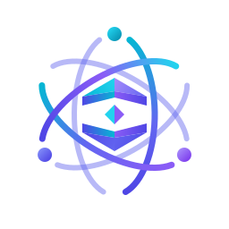

<div align="center">



# 🧠 AGI — Master Engineering Framework
### Autonomous Full-Cycle SDLC & Intelligence Core for Google Antigravity

[](plugin.json)
[](tests/)
[](memory/)
[](harness/)
[](hooks/command-guard.mjs)

<p align="center">
  <b>Продвинутая операционная среда разработки программного обеспечения полного цикла для Google Antigravity.</b><br>
  Трёхуровневая память Carpati, двухконтурная система гейтов, 24 специализированных субагента, протокол сдержанности Ponytail и автономный 4-стадийный харнесс.
</p>

[Ключевые возможности](#-ключевые-возможности) •
[Архитектура](#-архитектура-экосистемы) •
[24 Специалиста](#-ростер-24-sdlc-специалистов) •
[Установка](#-установка-и-быстрый-старт) •
[Релиз 1.5.0](#-что-нового-в-версии-150)

---

</div>

## 🌟 Ключевые возможности

* **🧠 Трёхуровневая память Carpati (L0 / L1 / L2):**
  * `L0 Runtime Working Cache`: сверхкомпактный активный контекст ($\le 35$ строк), исключающий деградацию рассуждений и насыщение токенов.
  * `Layer 1 (Raw Vault)`: неизменяемый архив ТЗ, дампов и логов с точечной адресацией строк (`lines X-Y`).
  * `Layer 2 (Compiled Wiki)`: синхронизированная база знаний архитектурных решений с семантическим версионированием SemVer.
* **🚦 Двухконтурная модель согласования (Gates 0–3):**
  * `Gate 0`: предварительное согласование архитектурных развилок через интерактивный выбор до генерации кода.
  * `Gate 1`: строгое правило *«Нет ТЗ с критериями AC-01..AC-xx — нет изменений в коде»*.
  * `Gate 2 & 3`: промежуточные контрольные точки и приёмка только при наличии таблицы доказательств верификации.
* **⚡ Безлимитный режим оркестрации (v1.5.0):**
  * Поддержка непрерывных цепочек вызовов через `ANTIGRAVITY_MAX_CHAIN_CALLS=unlimited` без искусственных прерываний на 5 вызовах.
* **🛡️ Усиленная безопасность ядра (Security Hardening):**
  * Автоматический перехват деструктивных команд файловой системы.
  * Защита от скрытых атак: декодирование команд PowerShell Base64 UTF-16LE (`-EncodedCommand`) и блокировка опасных инлайн-скриптов `node -e` и `python -c`.
* **🧪 Универсальный тестовый харнесс (Universal Harness²):**
  * Кросс-платформенное автоопределение тестовых сьютов для **Node.js/TypeScript** (`npm test`), **Python** (`pytest`), **Rust** (`cargo test`) и **Go** (`go test`).
  * Полное экранирование шума консоли в файлы `scratch/*.log`.
* **✂️ Инженерная сдержанность Ponytail & Микромодульность:**
  * Лестница сдержанности из 7 ступеней: `YAGNI` $\to$ `Re-use` $\to$ `Stdlib` $\to$ `Platform` $\to$ `Dependencies` $\to$ `Minimal Expression` $\to$ `Minimum Code`.
  * Лимит на новые файлы: не более **150 строк**, на функции: не более **30 строк**.

---

## 🏛️ Архитектура экосистемы

```
                                  [Пользователь]
                                        │
                                        ▼
    ┌───────────────────────────────────────────────────────────────────────┐
    │  Loop 1: Стратегическое выравнивание и гейты (Human-in-the-Loop)      │
    │  • Gate 0: Интерактивный опрос и пресеты архитектуры                  │
    │  • Gate 1: Формирование SPEC-YYYY-NNN с матрицей приёмки AC-xx       │
    └───────────────────────────────────┬───────────────────────────────────┘
                                        │
                                        ▼
    ┌───────────────────────────────────────────────────────────────────────┐
    │  Loop 2: Выбор субагентов и сдержанность (Selection & Restraint)      │
    │  • Принцип «Reuse before Create» (аудит реестра с порогом >= 0.6)     │
    │  • 7-ступенчатая лестница сдержанности Ponytail (минус 40-50% кода)   │
    └───────────────────────────────────┬───────────────────────────────────┘
                                        │
                                        ▼
    ┌───────────────────────────────────────────────────────────────────────┐
    │  Loop 3: Параллельный рой и исполнение (Swarm & Shielded Execution)   │
    │  • Single-Turn Parallel Fan-Out (одновременный запуск независимых)    │
    │  • Экранирование тяжелых логов консоли в scratch/*.log                │
    │  • Ограниченный диалог Coder <-> Reviewer (максимум 2 раунда)         │
    └───────────────────────────────────┬───────────────────────────────────┘
                                        │
                                        ▼
    ┌───────────────────────────────────────────────────────────────────────┐
    │  Loop 4: Самообучение и память (Harness² & Memory Synchronization)    │
    │  • 4-стадийный харнесс (Память -> Микромодули -> Тесты -> Релизы)     │
    │  • Запись уроков и инвариантов в 099_learnings.md                     │
    │  • Синхронизация L0 (<35 строк) / L1 Vault / L2 Wiki                  │
    └───────────────────────────────────┬───────────────────────────────────┘
                                        │
                                        ▼
                             [Gate 3: Сдача задачи]
                          Таблица доказательств AC-xx
```

---

## 👥 Ростер 24 SDLC-специалистов

Плагин включает 24 узкопрофильные роли субагентов, распределенные по 4 функциональным доменам:

| Домен | Роли субагентов | Профиль компетенций |
| :--- | :--- | :--- |
| **🎨 UI/UX & Frontend** | `sub_agent_color_stylist`<br>`sub_agent_ux_stylist`<br>`sub_agent_ui_stylist`<br>`sub_agent_coder` | 8pt сетка, типографика, WCAG/APCA контраст, компоненты React/Tailwind, автоматизированная проверка верстки через headless браузер. |
| **⚙️ Core Engineering** | `orchestrator`<br>`backend-specialist`<br>`frontend-specialist`<br>`database-architect`<br>`mobile-developer`<br>`game-developer`<br>`devops-engineer`<br>`performance-optimizer` | Высоконагруженные API, микросервисы, стейт-менеджмент, схемы SQL/NoSQL миграций, мобильные стеки, Three.js, CI/CD и Core Web Vitals. |
| **🛡️ QA, Security & Resilience** | `security-auditor`<br>`penetration-tester`<br>`qa-automation-engineer`<br>`test-engineer`<br>`debugger`<br>`code-archaeologist` | OWASP 2025, фаззинг, Playwright E2E сьюты, TDD-конвейеры, анализ дампов ошибок и рефакторинг легаси-монолитов. |
| **📋 Product & Intelligence** | `product-manager`<br>`product-owner`<br>`project-planner`<br>`documentation-writer`<br>`explorer-agent`<br>`seo-specialist` | Декомпозиция пользовательских историй, приоритизация MVP, построение WBS-графов, безопасное исследование репозиториев и GEO/SEO. |

---

## 🚀 Установка и быстрый старт

### Способ 1: Установка в профиль Antigravity (Рекомендуется)
Склонируйте репозиторий в каталог плагинов Antigravity:

```powershell
git clone https://github.com/LoveBitterMuffin/agi.git "$env:USERPROFILE\.gemini\config\plugins\antigravity-unified-core"
```

### Способ 2: Включение безлимитного режима оркестрации
Для снятия ограничения на 5 последовательных инструментальных шагов установите постоянную переменную окружения:

```powershell
[Environment]::SetEnvironmentVariable("ANTIGRAVITY_MAX_CHAIN_CALLS", "unlimited", "User")
```

### Способ 3: Запуск проверочного набора тестов
Убедитесь в корректности установки запуском автоматического тестового набора:

```powershell
cd "$env:USERPROFILE\.gemini\config\plugins\antigravity-unified-core"
node --test tests/*.test.mjs
```
*(Ожидаемый результат: 32 tests passed, 0 failures).*

---

## 📦 Что нового в версии 1.5.0

* 🛡️ **Security Hardening:** закрыты уязвимости обхода фильтра команд через кодирование PowerShell Base64 UTF-16LE (`-EncodedCommand`) и инлайн-скрипты `node -e` и `python -c`.
* 🧪 **Universal Multi-Stack Harness:** тестовый раннер `run-harness.ps1` полностью отвязан от унаследованных путей и динамически поддерживает Node.js, Python, Rust и Go.
* ⚡ **Autonomous Tool-Chaining:** штатная поддержка безлимитных сессий через `ANTIGRAVITY_MAX_CHAIN_CALLS=unlimited`.
* 📊 **Расширенный тестовый пакет:** добавлены сьюты `tests/harness-detector.test.mjs` и расширен `tests/security-and-registry.test.mjs` (32 теста, 100% pass rate).
* 📝 **Официальный релизный контур:** стандартизированный `CHANGELOG.md`, актуализированный `plugin.json` и синхронизация памяти.

---

## 📄 Лицензия

Распространяется под лицензией MIT. Подробности в файле [LICENSE](LICENSE) (при наличии) или [plugin.json](plugin.json).
