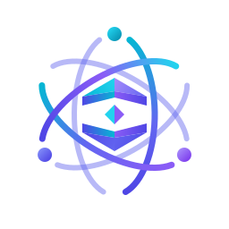
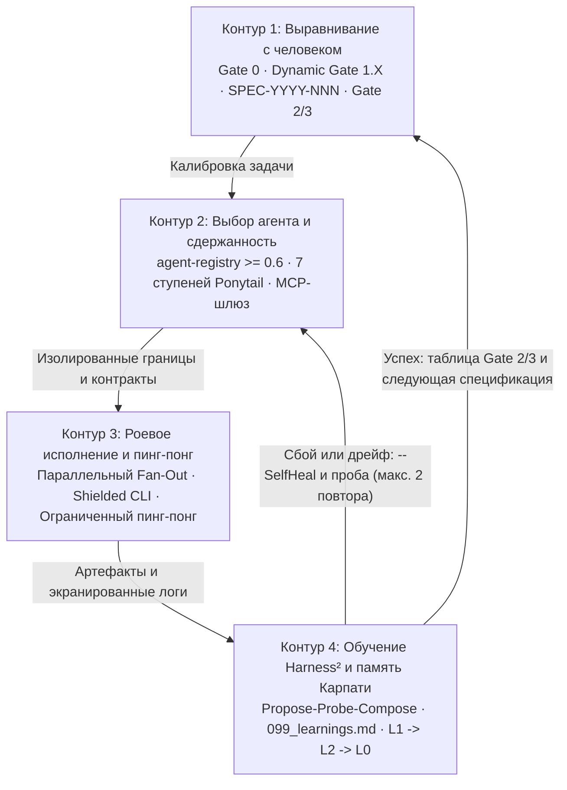

<div align="center">



# AGI

**Автономный плагин когнитивной инженерии для Antigravity**

[English](README.md) | [Русский](README.ru.md)

[](https://opensource.org/licenses/MIT)
[](plugin.json)
[](#66-навыков-skills)
[](#24-специализированных-агента-sdlc)
[](#7-базовых-правил-и-mcp-шлюз)
[](#архитектура-жизненного-цикла-хуков)

*Двухслойная память Карпати · Динамические гейты уточнения · 7 ступеней сдержанности Ponytail · Самовосстанавливающийся CI/CD Harness² · UI/UX-рой · 24 SDLC-специалиста*

</div>

---

## Концепция

**AGI** превращает ИИ-ассистента из одноразового генератора кода в **замкнутую когнитивную инженерную систему** для Antigravity. Вместо бесконтрольной генерации шаблонного кода AGI проводит каждую задачу через четыре взаимосвязанных контура:

1. **Восприятие и память (`Двухслойная архитектура Карпати`):** Неизменяемые сырые логи и спецификации (`L1`) компилируются в главы вики с SemVer-версионированием (`L2`) и сжимаются в сверхкомпактную сводку активного спринта (`L0`, `< 35` строк) до начала работы.
2. **Планирование и уточнение (`Двухконтурные гейты решений`):** Неоднозначные требования никогда не закрываются молчаливыми допущениями. `Gate 0` и `Dynamic Gate 1.X` заранее разрешают развилки по архитектуре, UX и зависимостям, фиксируя проверяемые критерии приёмки (`SPEC-YYYY-NNN`).
3. **Сдержанное исполнение (`Ponytail + параллельный рой`):** Перед написанием кода специалисты проходят **7-ступенчатую лестницу сдержанности**, проверяют реестр существующих агентов (`Reuse before Create`) и выполняют изолированные изменения в непересекающихся доменах или Git-worktree.
4. **Самовосстанавливающаяся верификация (`Harness и Harness²`):** Хуки перехватывают деструктивные команды, экранируют длинные логи терминала на диск, ограничивают циклы `Coder <-> Reviewer`, сохраняют сбои в `memory/harness_incidents.json` и кристаллизуют исправления в `099_learnings.md`.

### Навигация

- [Четырёхконтурная архитектура](#четырёхконтурная-архитектура)
- [Глубокий разбор и живая демонстрация 1: Harness и Harness²](#harness-showcase)
- [Глубокий разбор и живая демонстрация 2: Ponytail (7 ступеней сдержанности)](#ponytail-showcase)
- [Полный каталог экосистемы](#полный-каталог-экосистемы)
- [Руководство по установке и развёртыванию](#руководство-по-установке-и-развёртыванию)

---

## Четырёхконтурная архитектура

AGI работает как **непрерывный реентерабельный четырёхконтурный конечный автомат** ([`rules/AGENTS.md`](rules/AGENTS.md)), а не линейный однопроходный конвейер. Каждая веха либо возвращает доказательства верификации пользователю, либо повторно входит в цикл для ограниченного автовосстановления.



### Телеметрия четырёх контуров и адаптивный триаж задач

Перед запуском субагентов или закрытием этапа оркестратор выводит в чат проверяемую карточку **Quad-Loop Execution Telemetry** (в `v1.0.1` детерминированно контролируется гибридным защитником **Hybrid Quad-Loop Telemetry Guard** в [`hooks/quad-loop-guard.mjs`](hooks/quad-loop-guard.mjs)):

```markdown
### 🔄 Quad-Loop Execution Telemetry
- **[Loop 1 Human Gate]:** Active Spec ID / Sub-Gate 1.X status
- **[Loop 2 Selection & Restraint]:** agent-registry match score, selected agent, Ponytail rung, MCP tools
- **[Loop 3 Swarm Execution]:** Subagent role, resource boundaries, scratch log path
- **[Loop 4 Learning & Memory]:** Harness² status, L0 context clamping lines <= 35
```

Входящие задачи автоматически классифицируются скриптами [`scripts/triage-task.ps1`](scripts/triage-task.ps1) и [`scripts/estimate-complexity.ps1`](scripts/estimate-complexity.ps1) (с двуязычным **EN/RU** распознаванием команд и вопросов) по четырём уровням сложности:

| Архетип | Масштаб задачи | Гейты и субагенты | Бюджет токенов |
|:---|:---|:---|:---|
| `T0_INSTANT` | Информационный запрос, статус без правок | Быстрый путь (Fast-Path) в основном потоке | `< 1 000` токенов |
| `T1_HOTFIX` | Точечный патч одного файла или опечатки | Встроенная проверка, Ponytail, 1 целевой тест | `1 500 – 3 000` токенов |
| `T2_FEATURE` | Новая функция или подсистема (`>= 2` файлов) | Обязательный `Gate 0` + `SPEC-YYYY-NNN`, параллельный рой | `8 000 – 15 000` токенов |
| `T3_EPIC` | Архитектурный рефакторинг, редизайн, миграция | Жёсткий `Gate 0` + утверждение Spec, изолированный worktree-рой | `20 000 – 40 000` токенов |

---

<a id="harness-showcase"></a>
## Глубокий разбор и живая демонстрация 1: Harness и Harness²

AGI обеспечивает дисциплину исполнения на двух уровнях: детерминированные **хуки жизненного цикла** в [`hooks.json`](hooks.json) и автономная цепочка верификации **Harness² Propose-Probe-Compose**.

### Архитектура жизненного цикла хуков

Файл [`hooks.json`](hooks.json) подключает **5 событий жизненного цикла** (`PreToolUse`, `PostToolUse`, `SessionStart`, `PreInvocation` и `Stop`) через **5 ESM-обработчиков** на Node.js:

| Событие хука | Матчер | Скрипт-обработчик | Механизм защиты и поведения |
|:---|:---|:---|:---|
| `PreToolUse` | `run_command`, `invoke_subagent` | [`hooks/validate-tool-call.mjs`](hooks/validate-tool-call.mjs) | Блокирует **6 шаблонов деструктивных команд** (`unix-root-delete`, `filesystem-format`, `raw-disk-overwrite`, `windows-drive-format`, `windows-root-delete`, `windows-cmd-root-delete`) с кодом выхода `1`. Ведёт счётчик последовательных вызовов по беседам через [`hooks/tool-chain-state.mjs`](hooks/tool-chain-state.mjs). Для `invoke_subagent` вызывает `evaluatePreSubagent()` из [`hooks/quad-loop-guard.mjs`](hooks/quad-loop-guard.mjs) и отклоняет вызов (`decision: "deny"`, код `2`, до 2 попыток на ход), пока в транскрипте активного хода нет карточки Quad-Loop Telemetry (при отсутствии транскрипта пропускает открыто). |
| `PostToolUse` | `run_command` | [`hooks/harness-post-tool.mjs`](hooks/harness-post-tool.mjs) | Перехватывает ненулевые коды возврата и ошибки, записывает инцидент (срез ошибки до 500 символов, буфер до 50 записей) в [`memory/harness_incidents.json`](memory/harness_incidents.json) и инжектирует контекст `[Harness² Active Loop 4]`. |
| `SessionStart` | `—` | [`hooks/session-start.mjs`](hooks/session-start.mjs) | Сбрасывает счётчик цепочки вызовов, запускает `syncWorkspace()` ([`scripts/sync-workspace-core.mjs`](scripts/sync-workspace-core.mjs)) в корне проекта (`.agents`, `package.json`, `.git`, `AGENTS.md`, `pyproject.toml`, `Cargo.toml`) для очистки дублирующихся UTF-8 BOM и синхронизации скриптов/агентов/`AGENTS.md`, а также выдаёт официальный контракт `injectSteps` с `systemMessage` (`AGI v1.0.1 active`, `24 SDLC agents`, `66 skills loaded`). |
| `PreInvocation` | `—` | [`hooks/reset-tool-chain.mjs`](hooks/reset-tool-chain.mjs), [`hooks/quad-loop-guard.mjs`](hooks/quad-loop-guard.mjs) (`--event pre-invocation`) | Обнуляет счётчик цепочки вызовов при `invocationNum === 0` или новом `lastUserInput`, сохраняя счётчики телеметрии хода между повторами `Stop`. Если карточка телеметрии отсутствует в хвосте транскрипта (`256 KB`), инжектирует живые метрики (`chainCalls`, `incidents`, `stopRetries`, `subagentDenies`) через `injectSteps.ephemeralMessage`, а после повтора `Stop` однократно добавляет резервную карточку `systemMessage.metadata.user_markdown`. |
| `Stop` | `—` | [`hooks/quad-loop-guard.mjs`](hooks/quad-loop-guard.mjs) (`--event stop`), [`hooks/reset-tool-chain.mjs`](hooks/reset-tool-chain.mjs) | При `terminationReason === "NO_TOOL_CALL"`, если выполнялась работа (`>= 2` ответов планировщика или вызов `invoke_subagent`/`write_file`/`edit_file`/`run_command`) без карточки телеметрии, принудительно требует **1 повтор** (`decision: "continue"`). На финальном завершении полностью сбрасывает счётчики цепочки и телеметрии хода. |

### Цикл Harness² Propose-Probe-Compose и инструменты верификации

Протокол [`skills/harness2-learning/SKILL.md`](skills/harness2-learning/SKILL.md) превращает ошибки тестов и исключения времени выполнения в постоянный иммунитет системы:

1. **Propose (Гипотеза):** Анализ среза стека из `harness-post-tool.mjs` и формулировка минимального исправления инварианта.
2. **Probe (Изолированная проба):** Проверка правки в изолированном Git-worktree ([`scripts/manage-worktree.ps1`](scripts/manage-worktree.ps1)) через экранированный запуск команд.
3. **Compose (Фиксация опыта):** Запись проверенного инварианта в `memory/wiki/chapters/099_learnings.md` по строгой схеме `[LRN-YYYY-NNN]` (`Date / Trigger`, `Root Cause`, `Anti-Pattern`, `Deterministic Invariant`, `Verification Evidence`).

Вспомогательные инструменты удерживают контекст компактным и гарантируют воспроизводимость:

- **Экранированный запуск CLI ([`scripts/run-shielded.ps1`](scripts/run-shielded.ps1)):** Перенаправляет полный вывод команд в `scratch/logs/<timestamp>_<name>.log`, возвращая только код завершения, длительность, статистику файла и при сбое — срез последних **15 строк** (`-TailLines 15`).
- **Ограниченный цикл пинг-понга ([`scripts/run-pingpong.ps1`](scripts/run-pingpong.ps1)):** Проверяет связку `code-reviewer <-> defect-fixer` с предохранителем (`-MaxCycles 3` по умолчанию, режим сухого прогона `-VerifyOnly`; [`rules/AGENTS.md`](rules/AGENTS.md) ограничивает межагентный диалог 2 раундами), выявляя ошибки памяти, маркеры конфликтов Git и битую ANSI-кодировку.
- **Автономное самовосстановление ([`scripts/self-heal.ps1`](scripts/self-heal.ps1)):** Синхронизирует расхождения SemVer между главами вики и `Index.md`, корректирует выходящие за границы ссылки на строки в Raw Vault и удаляет старые логи старше 48 часов.
- **Триаж сложности и аллокатор TERA ([`scripts/triage-task.ps1`](scripts/triage-task.ps1), [`scripts/estimate-complexity.ps1`](scripts/estimate-complexity.ps1)):** Определяет архетип задачи (`T0`–`T3`), бюджет токенов и состав роя.
- **Верификатор UI-контрастности и доступности ([`scripts/verify-ui.mjs`](scripts/verify-ui.mjs)):** Вычисляет коэффициент контрастности WCAG (`calculateContrast`) и проверяет разметку на соответствие экранам `375px (Mobile)` и `1440px (Desktop)`, наличие `alt`, запрет текста мельче 12px, видимые состояния фокуса, плавные переходы и запрет сырых эмодзи внутри `<button>`.

### Живая демонстрация CLI — Harness, хуки, триаж задач и валидация манифеста

Все приведённые ниже команды выполнены непосредственно в корне репозитория:

```bash
$ node --test tests/tool-chain-hooks.test.mjs tests/agi-manifest.test.mjs tests/quad-loop-telemetry.test.mjs
TAP version 13
# Subtest: plugin.json defines AGI branding, allowed keys, and valid SVG logo
ok 1 - plugin.json defines AGI branding, allowed keys, and valid SVG logo
# Subtest: hooks.json is valid JSON under "agi" and all referenced .mjs scripts exist
ok 2 - hooks.json is valid JSON under "agi" and all referenced .mjs scripts exist
# Subtest: repository export contains no Python bytecode artifacts and has clean incident log
ok 3 - repository export contains no Python bytecode artifacts and has clean incident log
# Subtest: AC-01: SessionStart emits official injectSteps contract for AGI v1.0.1
ok 4 - AC-01: SessionStart emits official injectSteps contract for AGI v1.0.1
# Subtest: AC-01: inspectTurnTranscript fails open and slices 256KB tail by latest USER_INPUT
ok 5 - AC-01: inspectTurnTranscript fails open and slices 256KB tail by latest USER_INPUT
# Subtest: AC-01: evaluatePreInvocation injects live metrics and single-shot user_markdown fallback
ok 6 - AC-01: evaluatePreInvocation injects live metrics and single-shot user_markdown fallback
# Subtest: AC-02: validate-tool-call denies invoke_subagent twice without card then allows, and allows when card exists
ok 7 - AC-02: validate-tool-call denies invoke_subagent twice without card then allows, and allows when card exists
# Subtest: AC-03: Stop enforces once on work without card, preserves counters across PreInvocation, and resets at terminal Stop
ok 8 - AC-03: Stop enforces once on work without card, preserves counters across PreInvocation, and resets at terminal Stop
# Subtest: extractToolName and extractCommand support Antigravity camelCase toolCall payloads
ok 9 - extractToolName and extractCommand support Antigravity camelCase toolCall payloads
# Subtest: unlimited consecutive calls are allowed and isolated per conversation
ok 10 - unlimited consecutive calls are allowed and isolated per conversation
# Subtest: counter resets automatically on new lastUserInput, invoke_subagent, and resetChainState
ok 11 - counter resets automatically on new lastUserInput, invoke_subagent, and resetChainState
# Subtest: destructive command block rules remain enforced
ok 12 - destructive command block rules remain enforced
# Subtest: reset-tool-chain.mjs CLI resets state on PreInvocation and Stop payloads
ok 13 - reset-tool-chain.mjs CLI resets state on PreInvocation and Stop payloads
1..13
# tests 13
# suites 0
# pass 13
# fail 0
# duration_ms 592.8492
```

```powershell
# 1. Проверка файрвола деструктивных команд (PreToolUse хук)
PS> '{"toolCall":{"name":"run_command","args":{"CommandLine":"rm -rf /"}}}' | node hooks/validate-tool-call.mjs
BLOCKED by AGI (unix-root-delete): recursive deletion of the filesystem root.
# Код выхода: 1

# 2. Триаж архетипа задачи (классификатор T0-T3)
PS> powershell -NoProfile -ExecutionPolicy Bypass -File scripts/triage-task.ps1 -Task "Refactor auth module with tests" -Json
{"Task":"Refactor auth module with tests","Archetype":"T3_EPIC","Title":"Architectural Epic / System Redesign","ExecutionFlow":"Dual-Loop Reflexive Pipeline (Gate 0 Inquiry -\u003e Spec Gate -\u003e Swarm Fan-Out -\u003e Release Audit)","SpecGate":"Hard Gate (Gate 0 ask_question + SPEC-YYYY-NNN Sign-off)","Subagents":"Full Swarm Mesh (Color, UX, UI, Coder in branch, Reviewer)","TokenBudget":"20,000 - 40,000 tokens (isolated in branch)","ModelTier":"pro / coordinator"}

# 3. Оценка сложности и выделение роя субагентов (TERA)
PS> powershell -NoProfile -ExecutionPolicy Bypass -File scripts/estimate-complexity.ps1 -Description "Multi-service payment pipeline" -JsonOutput
{
    "TaskDescription":  "Multi-service payment pipeline",
    "ComplexityScore":  3,
    "Tier":  "Tier 1 (Standard Slice / Feature \u0026 Defect Ping-Pong)",
    "TierCode":  "T1",
    "RecommendedModel":  "inherit (flash / standard)",
    "AllocatedSubagents":  [
                               "spec-verifier",
                               "self (worker)",
                               "defect-fixer",
                               "code-reviewer",
                               "test-runner"
                           ],
    "SpecRequired":  false,
    "WorktreeRequired":  false,
    "TokenBudget":  "3,000 - 8,000 tokens",
    "EstimatedDuration":  "30 - 60 seconds"
}

# 4. Строгая проверка манифеста плагина и инвентаря компонентов
PS> agy plugin validate . --strict --json
{
  "dir": ".",
  "manifest": "plugin.json",
  "name": "agi",
  "agentPluginsSpec": false,
  "components": {
    "agents": 24,
    "hooks": 1,
    "mcpServers": 0,
    "rules": 7,
    "sidecars": 0,
    "skills": 66
  },
  "findings": []
}
```

---

<a id="ponytail-showcase"></a>
## Глубокий разбор и живая демонстрация 2: Ponytail (7 ступеней сдержанности)

> *«Лучший код — это код, который вы не написали. Ленивы в решениях, но никогда — в чтении».*
> — [`skills/ponytail/SKILL.md`](skills/ponytail/SKILL.md) и [`rules/03-ladder-of-restraint.md`](rules/03-ladder-of-restraint.md)

Протокол **Ponytail** подавляет избыточную генерацию — спекулятивные фабрики, самописные аналоги стандартной библиотеки и лишние слои абстракции — нацеливаясь на **сокращение объёма кода на 40%–50%** без компромиссов по безопасности и тестированию.

### 7-ступенчатая лестница сдержанности

Перед созданием или изменением кода агенты последовательно проверяют каждую ступень сверху вниз и **останавливаются на самой нижней ступени, решающей задачу**:

```text
[Ступень 1: YAGNI]              Нужен ли этот код вообще? (Оспорить предпосылку)
       │
[Ступень 2: Re-use]             Есть ли это уже в кодовой базе? (Поиск по AST / символам)
       │
[Ступень 3: Stdlib]             Предоставляет ли это стандартная библиотека языка?
       │
[Ступень 4: Platform]           Может ли ОС, оболочка или рантайм решить это нативно?
       │
[Ступень 5: Dependencies]       Решает ли это уже установленная зависимость?
       │
[Ступень 6: Minimal Expression] Можно ли выразить логику одной чистой функцией или конвейером?
       │
[Ступень 7: Minimum Code]       Только тогда: минимум рабочего кода + 1 целевой тест.
```

| Ступень | Контрольный вопрос | Обязательное действие |
|:---|:---|:---|
| **1. YAGNI** | Действительно ли эта гибкость или фича нужна прямо сейчас? | Удалить или отклонить. При неясности уточнить через `Gate 1.X`. |
| **2. Re-use** | Есть ли идентичный или адаптируемый символ в проекте? | Найти через AST/поиск и переиспользовать вместо дублирования. |
| **3. Stdlib** | Решается ли задача встроенными API Node, Python, Go или PowerShell? | Использовать `structuredClone`, `crypto.randomUUID`, `URL`, `path` и др. |
| **4. Platform** | Подойдут ли нативные потоки ОС, конвейеры или команды shell? | Выбирать системные примитивы вместо обёрток из npm/pip. |
| **5. Dependencies** | Есть ли решение среди уже установленных пакетов? | Проверить манифесты; новые зависимости требуют одобрения `Gate 1.X`. |
| **6. Minimal Expression** | Достаточно ли одной чистой функции без классов и фабрик? | Заменить одноразовые `Helper`/`Factory`/`Manager` короткой функцией. |
| **7. Minimum Code** | Логику всё же нужно написать с нуля? | Написать минимальный код под критерии приёмки + 1 машинный тест. |

### Закон микромодульности и анти-слоп (Rule R-41)

Закреплено в [`rules/04-code-standards-and-micromodularity.md`](rules/04-code-standards-and-micromodularity.md):

- **Потолок размера файла:** новые файлы исходного кода не должны превышать **150 строк** (предупреждение на **100 строках**).
- **Потолок функции и вложенности:** функции — не более **30 строк**, глубина вложенности — `<= 3` уровней (ранние возвраты и guard-условия).
- **Храповик для легаси (Legacy Ratchet):** существующие файлы длиннее 150 строк не могут расти; новую логику выносят в соседние микромодули.
- **Устойчивость к сбоям:** пустые блоки `catch` / `except: pass` и сетевые/IPC-вызовы без таймаутов строго запрещены.
- **Правило R-41 (Anti-Slop):** запрещены тавтологические комментарии (`// возвращаем результат`), `TODO`/`FIXME` в коде, синтетические бейджи телеметрии в интерфейсе (`APCA AAA PASS`, `STATUS // NODE-PULSE`, `v2.4.0 // SPEC`, `CARD // CHAMFER`) и выдуманные аккредитации. Неподтверждённые данные маркируются явно: `[Плейсхолдер: ...]`.

### Автоматический контроль соблюдения Ponytail

- **[`hooks/audit-restraint.mjs`](hooks/audit-restraint.mjs):** проверяет `.ts`, `.js`, `.mjs`, `.py`, `.vue`, `.tsx`, `.jsx` на лимит в `150` строк и паттерны слопа Rule R-41.
- **[`scripts/audit-restraint.ps1`](scripts/audit-restraint.ps1):** анализирует diff рабочего дерева и новые файлы, отлавливает шаблонные классы `class *Helper|Factory|Wrapper|Manager` (ступени 2/6) и несогласованные установки пакетов `npm install` / `pip install` / `Install-Module` / `gem install` (ступень 5), поддерживает строгий режим `-Strict`.
- **[`scripts/audit-code.ps1`](scripts/audit-code.ps1):** проверяет новые файлы в `src/` на пороги `100`/`150` строк, а добавленные строки diff — на пустые `catch`/`except: pass`, `TODO`/`FIXME`, двуязычные EN/RU тавтологии и закомментированный мёртвый код.

### Иллюстрация «До / После» (Ступень 3 Stdlib + Ступень 6 Minimal Expression)

<details>
<summary>Иллюстративный пример: замена 16-строчного Helper-класса с пустым catch на 5-строчную чистую функцию + тест</summary>

**До (нарушает ступени 2/6 и 3 — лишний класс `Helper` и ручное клонирование):**
```typescript
class SessionCloneHelper {
  private readonly prefix: string;

  constructor(prefix = "sess") {
    this.prefix = prefix;
  }

  public createClonedPayload(source: Record<string, unknown>): Record<string, unknown> {
    try {
      const copy = JSON.parse(JSON.stringify(source));
      copy.id = `${this.prefix}_${Date.now()}_${Math.random().toString(16).slice(2)}`;
      return copy;
    } catch (_err) {}
    return {};
  }
}
```

**После (Ponytail: ступень 3 Stdlib + ступень 6 Minimal Expression + ступень 7 тест):**
```typescript
import { randomUUID } from "node:crypto";

export function cloneSession<T extends Record<string, unknown>>(source: T): T & { id: string } {
  return { ...structuredClone(source), id: `sess_${randomUUID()}` };
}
```
Сопровождается одной целевой автоматической проверкой (`assert.notEqual(cloned, original)` и проверкой формата UUID).

</details>

### Живая демонстрация CLI — аудиторы Ponytail и микромодульности

```powershell
# 1. Node-проверка лимита строк и анти-слоп шаблонов R-41 в hooks/
PS> node hooks/audit-restraint.mjs hooks
Auditing Ponytail & Micro-Modularity in: hooks
✅ Ponytail & Micro-Modularity Hard Gate: PASSED (0 violations).

# 2. Линтер микромодульности и чистоты кода
PS> powershell -NoProfile -ExecutionPolicy Bypass -File scripts/audit-code.ps1
==========================================
  Micro-Modularity & Anti-Slop Linter     
==========================================
------------------------------------------
[PASS] Micro-modularity and code hygiene verified. Zero violations.

# 3. Линтер 7 ступеней сдержанности Ponytail (-Strict)
PS> powershell -NoProfile -ExecutionPolicy Bypass -File scripts/audit-restraint.ps1 -Strict
==========================================
  Ponytail Ladder of Restraint Linter     
==========================================
Working Tree Metrics:
  Lines Added:   +1222
  Lines Deleted: -143
  New Files:     513 (Threshold: 5)
------------------------------------------
[PASS] Ponytail Restraint Enforced. Zero gratuitous boilerplate detected.
```

> *Примечание: счётчики diff рабочего дерева выше отражают фактический снимок локального каталога на момент предрелизной проверки; шаблонных `Helper`/`Factory`/`Wrapper`/`Manager`-классов или лишних установок пакетов не обнаружено (`exit 0`).*

---

## Полный каталог экосистемы

### Двухслойная память Карпати (`L1 -> L2 -> L0`)

Описана в [`rules/01-versioning-policy.md`](rules/01-versioning-policy.md) и [`rules/00-reading-protocol.md`](rules/00-reading-protocol.md):

| Слой | Путь хранения | Назначение и ограничения |
|:---|:---|:---|
| **L1 (Raw Vault)** | `memory/raw/vault/RAW-YYYY-NNN_<slug>.md` | Неизменяемое хранилище спецификаций, транскриптов и логов (чтение диапазонами `<= 250` строк). |
| **L2 (Compiled Wiki)** | `memory/wiki/chapters/*.md` | Главы знаний с версионированием SemVer (`MAJOR.MINOR.PATCH`) и точными указателями `lines X-Y` на L1. |
| **L0 (Working Cache)** | [`memory/MEMORY.md`](memory/MEMORY.md), `memory/logs/ActiveSprintLog.md` | Сжатый рабочий контекст через [`scripts/get-memory-brief.ps1`](scripts/get-memory-brief.ps1) (`<= 35` строк; сжатие лога спринта свыше `180` строк) и проверка через [`scripts/audit-memory.ps1`](scripts/audit-memory.ps1). |

### Двухконтурные гейты выравнивания с человеком

Описаны в [`rules/02-spec-first-protocol.md`](rules/02-spec-first-protocol.md):

| Гейт | Точка срабатывания | Механизм |
|:---|:---|:---|
| **Gate 0** | Старт новой фичи, редизайна или многошаговой задачи | Вызов `ask_question` с 2–4 вариантами решения; оптимальный вариант ставится первым с префиксом `(Recommended)`. |
| **Dynamic Gate 1.X** | Развилка архитектуры, UX, производительности или зависимостей | Интерактивный выбор развилки + утверждение формальной `SPEC-YYYY-NNN` с проверяемыми `AC-01..AC-N` (`RequestFeedback: true`). **Нет Spec = нет кода.** |
| **Gate 2** | Составные задачи (`>= 3` компонентов или UI-макетов) | Промежуточная демонстрация (каркас, diff, контрастность) до написания реактивной логики. |
| **Gate 3** | Завершение вехи | Обязательная **таблица доказательств верификации критериев приёмки**, связывающая каждый `AC-XX` с выводом тестов. |

### 24 специализированных агента SDLC

Определены в `agents/` и подбираются через [`hooks/agent-registry.mjs`](hooks/agent-registry.mjs) (`score >= 0.6` предписывает переиспользование `REUSE` вместо создания нового агента):

| Домен | Кол-во | Верифицированные профили агентов |
|:---|:---:|:---|
| **UI/UX- и Frontend-рой** | **4** | `sub_agent_color_stylist`, `sub_agent_ux_stylist`, `sub_agent_ui_stylist`, `sub_agent_coder` |
| **Базовая инженерия и архитектура** | **8** | `orchestrator`, `backend-specialist`, `frontend-specialist`, `database-architect`, `mobile-developer`, `game-developer`, `devops-engineer`, `performance-optimizer` |
| **QA, безопасность и надёжность** | **6** | `security-auditor`, `penetration-tester`, `qa-automation-engineer`, `test-engineer`, `debugger`, `code-archaeologist` |
| **Продукт, стратегия и разведка** | **6** | `product-manager`, `product-owner`, `project-planner`, `documentation-writer`, `explorer-agent`, `seo-specialist` |

```powershell
# Живой поиск в реестре агентов ("Reuse before Create", порог >= 0.6 -> REUSE)
PS> node hooks/agent-registry.mjs find "security audit"
{
  "query": "security audit",
  "count": 6,
  "decision": "REUSE",
  "status": "REUSE_RECOMMENDED",
  "topMatch": {
    "name": "security-auditor",
    "score": 1,
    "description": "Elite cybersecurity expert. Think like an attacker, defend like an expert. OWASP 2025, supply chain security, zero trust architecture. Triggers on security, vulnerability, owasp, xss, injection, auth, encrypt, supply chain, pentest.",
    "skills": "",
    "file": "security-auditor.md"
  },
  "matches": [ "... ещё 4 совпадения (backend-specialist, explorer-agent, orchestrator, penetration-tester)" ]
}
```

### 66 навыков (Skills)

AGI объединяет **13 навыков-слэш-команд** и **53 доменных и инженерных навыка** в каталоге `skills/`:

- **13 слэш-команд:** `/plan`, `/brainstorm`, `/create`, `/debug`, `/deploy`, `/enhance`, `/orchestrate`, `/preview`, `/remember`, `/status`, `/test`, `/verify`, `/coordinate`

<details>
<summary>53 доменных и инженерных навыка (нажмите, чтобы раскрыть полный каталог)</summary>

| Категория | Навыки |
|:---|:---|
| **Архитектура и планирование (9)** | `app-builder`, `architecture`, `behavioral-modes`, `brainstorming`, `coordinator-mode`, `intelligent-routing`, `parallel-agents`, `plan-writing`, `skillify` |
| **Сдержанность и качество кода (6)** | `clean-code`, `code-review-checklist`, `code-review-graph`, `lint-and-validate`, `ponytail`, `simplify-code` |
| **Память, документация и Harness² (8)** | `context-compression`, `documentation-templates`, `harness2-learning`, `i18n-localization`, `memory-system`, `release-audit`, `wiki-brief`, `wiki-ingest` |
| **Frontend, UI/UX, Mobile и Game (11)** | `design`, `design-spec`, `frontend-architecture`, `frontend-design`, `game-development`, `geo-fundamentals`, `mobile-design`, `nextjs-react-expert`, `seo-fundamentals`, `tailwind-patterns`, `web-design-guidelines` |
| **Backend, БД, системы и инфраструктура (11)** | `api-patterns`, `bash-linux`, `batch-operations`, `database-design`, `deployment-procedures`, `mcp-builder`, `nodejs-best-practices`, `powershell-windows`, `python-patterns`, `rust-pro`, `server-management` |
| **Безопасность, тестирование и отладка (8)** | `performance-profiling`, `red-team-tactics`, `systematic-debugging`, `tdd-workflow`, `testing-patterns`, `verify-changes`, `vulnerability-scanner`, `webapp-testing` |

</details>

### 7 базовых правил и MCP-шлюз

- **7 файлов правил (`rules/`):** [`AGENTS.md`](rules/AGENTS.md) (мастер-протокол четырёх контуров), [`00-reading-protocol.md`](rules/00-reading-protocol.md), [`01-versioning-policy.md`](rules/01-versioning-policy.md), [`02-spec-first-protocol.md`](rules/02-spec-first-protocol.md), [`03-ladder-of-restraint.md`](rules/03-ladder-of-restraint.md), [`04-code-standards-and-micromodularity.md`](rules/04-code-standards-and-micromodularity.md), [`05-parallel-swarm-dispatch.md`](rules/05-parallel-swarm-dispatch.md).
- **Межплагинный MCP-шлюз ([`references/mcp-catalog.md`](references/mcp-catalog.md)):** задаёт изолированную маршрутизацию ролей к `figma_*` (токены, макеты, FigJam), `chrome-devtools-*` (headless-инспекция 375px/1440px, DOM и консоль), `android-*` (эмуляторы AVD и Compose Preview) и `context7_*` (актуальные сигнатуры и документация библиотек).

### 39 дизайн-датасетов

По данным [`data/catalog-summary.json`](data/catalog-summary.json) (верифицировано `2026-11-04`), каталог `data/` включает **39 файлов датасетов и метаданных** (`13` корневых CSV + `22` CSV стеков в `data/stacks/` + `4` JSON-файла лицензий, провенанса и сводки) для офлайн-поиска через [`scripts/ui-search.py`](scripts/ui-search.py):

| Метрика каталога | Проверенное значение | Источники |
|:---|:---:|:---|
| **UI-стили** | **89** (`80` в поиске: `51` активный, `29` дополнительных; `9` устаревших) | `data/styles.csv` |
| **Продуктовые профили / Палитры / Профили рассуждений** | По **192** записи | `data/products.csv`, `data/colors.csv`, `data/ui-reasoning.csv` |
| **Шрифты Google Fonts и пары** | **1 934** шрифта · **74** шрифтовые пары | `data/google-fonts.csv`, `data/typography.csv`, [`data/google-font-licenses.json`](data/google-font-licenses.json) |
| **Иконки** | **1 617** (`105` кураторских + `1 512` Phosphor upstream) | `data/icons.csv`, [`data/phosphor-icons-upstream.json`](data/phosphor-icons-upstream.json) |
| **UX-гайды / Пресеты анимаций / Типы графиков** | **119** UX · **17** анимаций · **25** графиков | `data/ux-guidelines.csv`, `data/motion.csv`, `data/charts.csv` |
| **Рекомендации по фреймворк-стекам** | **22** стека · **1 278** строк рекомендаций | `data/stacks/*.csv` (`react`, `nextjs`, `vue`, `nuxtjs`, `nuxt-ui`, `svelte`, `astro`, `angular`, `html-tailwind`, `shadcn`, `laravel`, `react-native`, `flutter`, `swiftui`, `jetpack-compose`, `threejs`, `avalonia`, `javafx`, `uno`, `uwp`, `winui`, `wpf`) |

---

## Руководство по установке и развёртыванию

### Системные требования

- **Обязательно:** `Node.js >= 18` (ESM-хуки и встроенный раннер `node:test`), **Antigravity IDE** / CLI `agy`.
- **Опционально (для расширенной автоматизации на PowerShell/Python):** `PowerShell 5.1+` или `pwsh`, `Python >= 3.9`.

### Способ 1: Глобальное клонирование в `~/.gemini/config/plugins/agi`

**macOS / Linux (Bash):**
```bash
git clone https://github.com/LoveBitterMuffin/agi.git ~/.gemini/config/plugins/agi
```

**Windows (PowerShell):**
```powershell
git clone https://github.com/LoveBitterMuffin/agi.git "$env:USERPROFILE\.gemini\config\plugins\agi"
```

**Обновление установленного плагина:**
```bash
git -C ~/.gemini/config/plugins/agi pull
```
```powershell
git -C "$env:USERPROFILE\.gemini\config\plugins\agi" pull
```

### Способ 2: Установка через `agy plugin install` и валидация

Установка из локального клона или распакованного архива [GitHub Release](https://github.com/LoveBitterMuffin/agi/releases) со строгой проверкой манифеста:

```bash
git clone https://github.com/LoveBitterMuffin/agi.git ./agi
agy plugin install ./agi
agy plugin validate ./agi --strict --json
```

Запуск встроенных тестов хуков и манифеста (`13/13` пройдено в `tests/tool-chain-hooks.test.mjs`, `tests/agi-manifest.test.mjs` и `tests/quad-loop-telemetry.test.mjs`) для подтверждения целостности:

```bash
cd ./agi
node --test tests/tool-chain-hooks.test.mjs tests/agi-manifest.test.mjs tests/quad-loop-telemetry.test.mjs
```

### Способ 3: Командное развёртывание в рабочем пространстве

Подключите AGI к общему репозиторию команды как Git-подмодуль в `.agents/plugins/agi`:

```bash
git submodule add https://github.com/LoveBitterMuffin/agi.git .agents/plugins/agi
node .agents/plugins/agi/scripts/sync-workspace-core.mjs --target .
```

Либо укажите путь к плагину в конфигурации рабочего пространства `.agents/plugins.json`, чтобы вся команда работала с единым набором правил, хуков и агентов.

---

## Лицензия

Распространяется по лицензии **MIT License** — см. [`plugin.json`](plugin.json) и [opensource.org/licenses/MIT](https://opensource.org/licenses/MIT).
